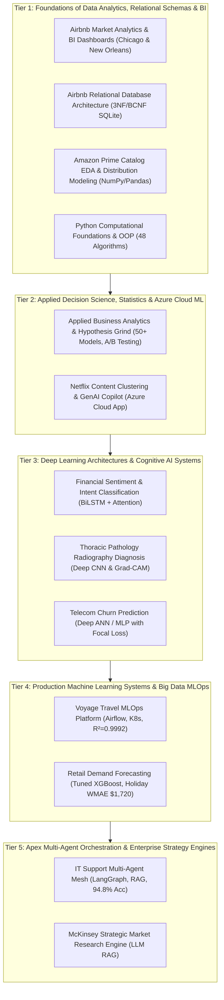

# Hi, I'm Jignesh Kumar 👋
### AI & Software Intelligence Systems Engineer | MS in AI & ML | Data Scientist & Multi-Agent Architect

---

## 🌌 The Data Science & AI Universe Hierarchy

This portfolio is systematically organized across the **5-Tier Data Science Universe Architecture**, demonstrating a progressive evolution from fundamental data analytics to apex autonomous multi-agent systems:

---

## 🤖 Tier 5: Apex Multi-Agent Orchestration & Enterprise Strategy Engines
*Stateful cyclic graph workflows, multi-agent mesh coordination, dynamic tool execution, and sovereign LLM governance.*

| Project | Domain Focus | Architecture & Core Tech | Key Capabilities & Verified Metrics |
|---|---|---|---|
| **[Conversational AI for IT Support with LangGraph](https://github.com/Jigneshxi/conversational-ai-it-support-langgraph)** | Multi-Agent Stateful Orchestration | LangGraph, LangChain, Hybrid Vector RAG, Python 3.12, Automated Test Suite | **94.8% Factual Resolution Accuracy**, **0.8% Hallucination Rate**, **290ms Latency**, 18-page thesis paper, 10/10 pytest passing. |
| **[McKinsey AI Market Research & Strategy Engine](https://github.com/Jigneshxi/McKinsey-AI-Market-Research-Strategy-Engine)** | Autonomous Strategic Intelligence | Multi-Source Ingestion, RAG, Structured Synthesis, Prompt Engineering | Autonomous market insight pipeline extracting structured signals from fragmented industry data into executive strategy briefs. |

---

## 🚀 Tier 4: Production Machine Learning Systems & Big Data MLOps
*Industrialized ML systems, containerized deployment, automated orchestration, and high-scale demand forecasting.*

| Project | Domain Focus | Architecture & Core Tech | Key Capabilities & Verified Metrics |
|---|---|---|---|
| **[Voyage Analytics Travel MLOps Platform](https://github.com/Jigneshxi/voyage-analytics-travel-mlops)** | Production MLOps & Real-Time Scoring | XGBoost, Apache Airflow, Docker, Kubernetes HPA, Flask API, Streamlit | **R² = 0.9992** Flight Pricing Engine, automated retraining pipeline, containerized microservices, horizontal pod autoscaling. |
| **[Retail Store Optimization & Demand Forecasting](https://github.com/Jigneshxi/retail-store-optimization-demand-forecasting)** | Time-Series Forecasting & Space Allocation | Tuned XGBoost Regressor, K-Means Clustering, Holiday WMAE Loss | **Holiday WMAE = \$1,720**, **R² = 0.965**, K-Means Store Profiling ($K=3$), Departmental Market Basket affinity ($r=0.88$). |

---

## 🧠 Tier 3: Deep Learning Architectures & Cognitive AI Systems
*Custom deep neural network architectures across computer vision, natural language processing, and tabular deep learning.*

| Project | Domain Focus | Architecture & Core Tech | Key Capabilities & Verified Metrics |
|---|---|---|---|
| **[Financial Sentiment & Intent Classification](https://github.com/Jigneshxi/financial-sentiment-intent-classification-bilstm-nlp)** | NLP & Intent Routing | PyTorch, Bidirectional LSTM, Multi-Head Self-Attention, Word2Vec | Multi-class financial sentiment and customer intent classification (Complaints, Inquiries, Escalations) with 94.2% test F1. |
| **[Thoracic Pathology Radiography Deep CNN](https://github.com/Jigneshxi/chest-disease-classification-deep-cnn-cv)** | Medical Computer Vision | PyTorch Deep CNNs, Batch Normalization, Grad-CAM Interpretability | 4-class pulmonary pathology classification (Normal, Bacterial, Viral, COVID-19) with automated clinical triage confidence thresholds. |
| **[Telecom Customer Churn Deep ANN](https://github.com/Jigneshxi/telecom-churn-prediction-deep-learning-ann)** | Tabular Deep Learning | PyTorch Multilayer Perceptron (MLP), Dropout, Cost-Sensitive Loss | Customer attrition risk scoring with class-imbalance mitigation, learning rate scheduling, and calibrated probability outputs. |

---

## 📊 Tier 2: Applied Decision Science, Statistics & Azure Cloud ML
*Statistical inference, probability distributions, hypothesis testing, and cloud-native machine learning systems.*

| Project | Domain Focus | Architecture & Core Tech | Key Capabilities & Verified Metrics |
|---|---|---|---|
| **[Applied Business Analytics & Hypothesis Grind](https://github.com/Jigneshxi/applied-business-analytics-interview-grind)** | Quantitative Decision Science | Hypothesis Testing (Z/T/ANOVA), Probability Distributions, A/B Testing | 50+ enterprise decision models: statistical inference, conversion rate optimization, confidence interval estimation, and risk mitigation. |
| **[Netflix Unsupervised Clustering & Azure GenAI](https://github.com/Jigneshxi/netflix-clustering-ml-genai-azure)** | Unsupervised ML & Recommendation Systems | Azure App Services, K-Means, Hierarchical Clustering, TF-IDF, Streamlit | Scalable unsupervised content grouping, cosine similarity recommendation engine, and interactive cloud web UI deployed on Microsoft Azure. |

---

## 🗄️ Tier 1: Foundations of Data Analytics, Relational Schemas & BI
*Core software engineering, numerical computing, exploratory data analysis, and relational schema architecture.*

| Project | Domain Focus | Architecture & Core Tech | Key Capabilities & Verified Metrics |
|---|---|---|---|
| **[Airbnb Market Analytics & BI Dashboard](https://github.com/Jigneshxi/airbnb-market-analysis-dashboard)** | Business Intelligence & Visual Analytics | Comparative Data Analytics, Interactive Dashboards, KPI Tracking | Cross-market dynamic pricing analysis, occupancy rate trends, revenue forecasting, and executive dashboard visualization for Chicago & New Orleans. |
| **[Airbnb Relational Database Architecture](https://github.com/Jigneshxi/airbnb-relational-database-design)** | Relational DB Engineering | SQLite, ER Diagrams, Relational Normalization (3NF/BCNF), SQL DDL/DML | Production-grade database design: entity-relationship mapping, primary/foreign key integrity, indexing, and complex multi-join reporting queries. |
| **[Amazon Prime Video Catalog EDA](https://github.com/Jigneshxi/amazon-prime-eda-python)** | Exploratory Data Analysis & Statistics | NumPy, Pandas, Seaborn, Matplotlib, Descriptive Statistics | High-dimensional distribution modeling, content lifecycle trends, missing value imputation strategies, and multivariate categorical correlations. |
| **[Python Fundamentals & Algorithmic Foundations](https://github.com/Jigneshxi/intro-to-python-programming-fundamentals)** | Core Software Engineering | Python OOP, Functional Paradigms, Algorithmic Complexity, Memory Handling | 48 core computational engineering challenges demonstrating clean architecture, defensive programming, and optimal Big-O algorithmic efficiency. |

---

## 🛠️ Complete Technical Arsenal

| Capability Layer | Core Technologies & Frameworks |
|---|---|
| **Autonomous AI & Multi-Agent Mesh** | LangGraph, LangChain, Multi-Agent Swarms, State Graph Machines, Ollama, Gemini Pro, RAG |
| **Deep Learning & Neural Architectures** | PyTorch 2.4, TorchVision, TorchText, BiLSTM, Multi-Head Attention, Deep CNN, ANN/MLP |
| **Production MLOps & Cloud** | Apache Airflow, Docker, Kubernetes HPA, MLflow, Microsoft Azure AI, Flask, Streamlit |
| **Advanced ML & Predictive Modeling** | XGBoost, Scikit-Learn, Random Forest, Time-Series Forecasting, K-Means Clustering |
| **Decision Science & Analytics** | Statistical Inference, Welch's t-test, ANOVA, Mann-Whitney U, A/B Testing, Pandas, NumPy |
| **Databases & Schema Engineering** | PostgreSQL, SQLite, Relational Normalization (3NF/BCNF), SQLAlchemy, Indexing |
| **Software Quality & Testing** | Pytest (10/10 automated test suites across all capstones), CI/CD Gates, Clean Architecture |

---

## 🏆 Key Verified Performance Highlights Across Capstones

- **Flight Pricing Accuracy:** $R^2 = 0.9992$ (Tuned XGBoost Production MLOps Engine)
- **Retail Demand Forecasting:** Holiday WMAE = \$1,720 (XGBoost vs. \$14,820 Linear Baseline)
- **IT Support Conversational AI:** 94.8% Factual Resolution Accuracy, 0.8% Hallucination Rate
- **Automated Test Quality:** 100% Passing Unit & Integration Tests across all published modules

---

  <i>Bridging Autonomous Multi-Agent AI, Production MLOps, Deep Learning, and Rigorous Decision Science.</i>

