# Hi, I'm Jignesh Kumar 👋
### AI & Software Intelligence Systems Engineer | MS in AI & ML | Data Scientist & Multi-Agent Architect

---

## 🎯 Executive Summary
Electrical & Instrumentation Engineer with a Master of Science (MS) in AI & Machine Learning. My engineering portfolio is systematically architected across the **Data Science & AI Universe Hierarchy**, progressing from core computational fundamentals and statistical inference to production MLOps, deep learning vision/NLP architectures, and apex autonomous multi-agent systems.

---

## 🌌 The Data Science & AI Universe Hierarchy

```mermaid
flowchart TD
    subgraph TIER5["Tier 5: Applied Thesis & Autonomous Multi-Agent Platforms"]
        A1["[13/13] IT Support Conversational AI (LangGraph State Graph, 94.8% Acc)"]
        A2["[14/15] McKinsey Strategic Market Research Engine (LLM Multi-Agent RAG)"]
    end

    subgraph TIER4["Tier 4: Deep Learning & Cognitive AI Engineering"]
        B1["[10/13] Telecom Churn Prediction (PyTorch Deep ANN / MLP, Cost-Sensitive Loss)"]
        B2["[11/13] Thoracic Pathology Diagnosis (PyTorch Deep CNN, Multi-Class CV)"]
        B3["[12/13] Financial Sentiment & Intent Classification (BiLSTM + Multi-Head Attention)"]
    end

    subgraph TIER3["Tier 3: Machine Learning Engineering & Production MLOps"]
        C1["[07/13] Voyage Travel MLOps Platform (XGBoost R²=0.9992, Airflow, K8s HPA)"]
        C2["[08/13] Distributed Big Data Banking Analytics (Hadoop, Hive, PySpark & Streaming)"]
        C3["[09/13] Retail Store Optimization & Demand Forecasting (Tuned XGBoost, WMAE $1,720)"]
    end

    subgraph TIER2["Tier 2: Applied Decision Science, Statistics & Azure Cloud ML"]
        D1["[05/13] Applied Business Analytics & Inference Grind (50+ Decision Models, A/B Testing)"]
        D2["[06/13] Netflix Content Clustering & GenAI Copilot (K-Means, Azure App Service)"]
    end

    subgraph TIER1["Tier 1: Foundations of Data Analytics, Relational Schemas & BI"]
        E1["[01/13] Python Computational Foundations & OOP (48 Algorithms, Big-O Efficiency)"]
        E2["[02/13] Amazon Prime Video Catalog EDA (High-Dimensional Distribution Modeling)"]
        E3["[03/13] Airbnb Relational Database Architecture (3NF/BCNF Normalization, SQLite)"]
        E4["[04/13] Airbnb Market Analytics & BI Dashboards (Chicago & New Orleans KPI Tracking)"]
    end

    TIER1 --> TIER2 --> TIER3 --> TIER4 --> TIER5
```

---

## 🏛️ Comprehensive Repository Matrix (The 15 Universe Projects)

### 🤖 Tier 5: Applied Thesis & Autonomous Multi-Agent Systems
*Stateful cyclic graph workflows, multi-agent mesh coordination, dynamic tool execution, and sovereign LLM governance.*

| Index | Project Repository | Domain Focus | Core Tech Stack | Verified Key Performance Highlights |
|:---:|---|---|---|---|
| **13/13** | **[conversational-ai-it-support-langgraph](https://github.com/Jigneshxi/conversational-ai-it-support-langgraph)** | Multi-Agent IT Support (Applied Thesis) | LangGraph, LangChain, Hybrid RAG, Python 3.12 | **94.8% Factual Accuracy**, **0.8% Hallucination Rate**, **290ms Latency**, 18-page university thesis paper, 10/10 pytest passed. |
| **14/15** | **[McKinsey-AI-Market-Research-Strategy-Engine](https://github.com/Jigneshxi/McKinsey-AI-Market-Research-Strategy-Engine)** | Autonomous Strategic Intelligence (AlmaX Flagship) | Multi-Source Ingestion, RAG, Structured Synthesis, Prompt Engineering | Enterprise-grade autonomous market intelligence extracting verified strategic signals from fragmented business data. |

---

### 🧠 Tier 4: Deep Learning & Cognitive AI Engineering
*Neural network architectures, multi-class computer vision, and bidirectional sequence modeling with self-attention.*

| Index | Project Repository | Domain Focus | Core Tech Stack | Verified Key Performance Highlights |
|:---:|---|---|---|---|
| **10/13** | **[telecom-churn-prediction-deep-learning-ann](https://github.com/Jigneshxi/telecom-churn-prediction-deep-learning-ann)** | Introduction to Deep Learning (AIE M1) | PyTorch 2.4, Deep ANN/MLP, Dropout, Cost-Sensitive Loss | Customer attrition modeling with non-linear activation tuning and cost-sensitive penalty weights. |
| **11/13** | **[chest-disease-classification-deep-cnn-cv](https://github.com/Jigneshxi/chest-disease-classification-deep-cnn-cv)** | Deep Learning for Computer Vision (AIE M2) | PyTorch Deep CNN, TorchVision, Data Augmentation | Multi-class thoracic pathology classification (Normal, Bacterial, Viral, COVID-19) with automated clinical triage. |
| **12/13** | **[financial-sentiment-intent-classification-bilstm-nlp](https://github.com/Jigneshxi/financial-sentiment-intent-classification-bilstm-nlp)** | Deep Learning for NLP (AIE M3) | PyTorch BiLSTM, Multi-Head Self-Attention, GloVe Embeddings | High-precision multi-class financial sentiment and customer intent classification (Escalation, Complaint, Inquiry). |

---

### 🚀 Tier 3: Machine Learning Engineering & Production MLOps
*Industrialized ML systems, containerized deployment, automated orchestration, big data engines, and demand forecasting.*

| Index | Project Repository | Domain Focus | Core Tech Stack | Verified Key Performance Highlights |
|:---:|---|---|---|---|
| **07/13** | **[voyage-analytics-travel-mlops](https://github.com/Jigneshxi/voyage-analytics-travel-mlops)** | Production ML Systems (MLE M1) | XGBoost, Airflow, Flask, Streamlit, Docker, Kubernetes HPA | **$R^2 = 0.9992$**, end-to-end flight pricing MLOps pipeline with automated daily retraining DAG and autoscaling cluster. |
| **08/13** | **[distributed-machine-learning-spark-banking](https://github.com/Jigneshxi/distributed-machine-learning-spark-banking)** | Distributed Machine Learning (MLE M2) | Hadoop, Hive HQL, PySpark, Spark MLlib, Spark Streaming | 5-part big data banking analytics platform: MapReduce, Hive queries, Spark ML predictive models & real-time streaming. |
| **09/13** | **[retail-store-optimization-demand-forecasting](https://github.com/Jigneshxi/retail-store-optimization-demand-forecasting)** | Advanced Machine Learning (MLE M3) | Tuned XGBoost, K-Means Clustering, Isolation Forest, WMAE | **Holiday WMAE = \$1,720** (vs. \$14,820 Linear Baseline), **$R^2 = 0.965$**, store segmentation ($K=3$), 10/10 pytest passed. |

---

### 📊 Tier 2: Applied Decision Science, Statistics & Azure Cloud ML
*Statistical inference, hypothesis testing, A/B experimentation, unsupervised learning, and cloud-native Copilots.*

| Index | Project Repository | Domain Focus | Core Tech Stack | Verified Key Performance Highlights |
|:---:|---|---|---|---|
| **05/13** | **[applied-business-analytics-interview-grind](https://github.com/Jigneshxi/applied-business-analytics-interview-grind)** | Applied Business Analytics (DS&AAI M1) | Hypothesis Testing (Z/T/ANOVA), Probability, A/B Testing | 50+ enterprise decision models: statistical inference, conversion rate optimization, confidence intervals & risk mitigation. |
| **06/13** | **[netflix-clustering-ml-genai-azure](https://github.com/Jigneshxi/netflix-clustering-ml-genai-azure)** | ML & Azure Generative AI (DS&AAI M2) | Azure App Services, K-Means, Agglomerative Clustering, Streamlit | Unsupervised catalog clustering, cosine similarity content recommendations, and cloud web app deployed on Microsoft Azure. |

---

### 🗄️ Tier 1: Foundations of Data Analytics, Relational Schemas & BI
*Core computational engineering, exploratory distribution analysis, 3NF/BCNF relational modeling, and executive BI dashboards.*

| Index | Project Repository | Domain Focus | Core Tech Stack | Verified Key Performance Highlights |
|:---:|---|---|---|---|
| **01/13** | **[intro-to-python-programming-fundamentals](https://github.com/Jigneshxi/intro-to-python-programming-fundamentals)** | Computer Programming (DA&BI M1) | Python OOP, Functional Paradigms, Algorithmic Complexity | 48 computational challenges demonstrating clean architecture, defensive error handling, and optimal Big-O algorithmic runtime. |
| **02/13** | **[amazon-prime-eda-python](https://github.com/Jigneshxi/amazon-prime-eda-python)** | Numerical Programming & EDA (DA&BI M2) | NumPy, Pandas, Seaborn, Matplotlib, Descriptive Stats | High-dimensional distribution modeling, content lifecycle dynamics, missing value imputation, and multivariate correlations. |
| **03/13** | **[airbnb-relational-database-design](https://github.com/Jigneshxi/airbnb-relational-database-design)** | Relational Databases (DA&BI M3) | SQLite, ER Diagrams, Relational Normalization (3NF/BCNF) | Production schema architecture: entity-relationship mapping, primary/foreign key integrity, indexing & multi-join queries. |
| **04/13** | **[airbnb-market-analysis-dashboard](https://github.com/Jigneshxi/airbnb-market-analysis-dashboard)** | BI & Data Visualization (DA&BI M4) | Comparative Analytics, Interactive Dashboards, KPI Tracking | Cross-market dynamic pricing analysis, occupancy rate forecasting, and executive dashboard visualization for Chicago & New Orleans. |

---

### 📌 Master Portfolio Overview
| Index | Project Repository | Description |
|:---:|---|---|
| **15/15** | **[Jigneshxi](https://github.com/Jigneshxi/Jigneshxi)** | Master Executive Engineering Portfolio, Global Resume, and Comprehensive Data Science Universe Directory. |

---

## 🛠️ Complete Technical Arsenal

| Capability Layer | Core Technologies & Frameworks |
|---|---|
| **Autonomous AI & Multi-Agent Mesh** | LangGraph, LangChain, Multi-Agent Swarms, State Graph Machines, Ollama, Gemini Pro, ChromaDB, Hybrid RAG |
| **Deep Learning & Neural Architectures** | PyTorch 2.4, TorchVision, TorchText, BiLSTM, Multi-Head Self-Attention, Deep CNN, ANN/MLP |
| **Production MLOps & Big Data** | Apache Airflow, Docker, Kubernetes HPA, Apache Spark, Hadoop, Hive HQL, MLflow, Microsoft Azure AI, Flask, Streamlit |
| **Machine Learning & Predictive Modeling** | XGBoost, Scikit-Learn, Random Forest, Time-Series Forecasting, K-Means Clustering, Isolation Forests |
| **Decision Science & Analytics** | Statistical Inference, Welch's t-test, ANOVA, Mann-Whitney U, A/B Testing, Pandas, NumPy, SciPy |
| **Databases & Schema Engineering** | PostgreSQL, SQLite, Relational Normalization (3NF/BCNF), SQL DDL/DML, SQLAlchemy, Indexing |
| **Software Quality & Verification** | Pytest (10/10 automated test suites across all capstones), CI/CD Gates, Strict Type Hinting, Clean Architecture |

---

## 🏆 Portfolio Key Verified Metrics Summary

- **Flight Pricing Accuracy:** $R^2 = 0.9992$ (Tuned XGBoost Production MLOps Engine)
- **Retail Demand Forecasting:** Holiday WMAE = \$1,720 (Tuned XGBoost vs. \$14,820 Linear Baseline)
- **Conversational AI for IT Support:** 94.8% Factual Resolution Accuracy, 0.8% Hallucination Rate (18-Page Thesis)
- **Automated Test Coverage:** 100% Passing Unit & Integration Tests (`pytest`) across all modules

---

  <i>Bridging Autonomous Multi-Agent AI, Production MLOps, Deep Learning, and Rigorous Decision Science.</i>

