# Hi, I'm Jignesh Kumar 👋
### AI & Systems Intelligence Engineer | MS in AI & ML (Woolf University & IIT Patna) | AI/ML Engineer @ VVnT SeQuor | Autonomous Multi-Agent Architect & MLOps Specialist

---

## 🎯 Executive Profile & Core Philosophy
**AI & Systems Intelligence Engineer** with an engineering background in **Instrumentation & Control** and an advanced **Master of Science (MS) in Computer Science: Machine Learning & AI** from **Woolf University** and **Vishleshan I-Hub, IIT Patna (AlmaBetter)**. Currently engineering AI/ML platforms at **VVnT SeQuor**.

My engineering portfolio is structured across the **Data Science & AI Universe Hierarchy**, progressing systematically from core computational and database foundations to production MLOps, deep learning vision/NLP architectures, and sovereign autonomous multi-agent meshes.

---

## 🌌 The Data Science Universe Progression Roadmap

```mermaid
flowchart LR
    T1["<b>Tier 1: Foundations</b><br/>Python, SQL & BI"]
    --> T2["<b>Tier 2: Decision Science</b><br/>Inference & Azure ML"]
    --> T3["<b>Tier 3: MLOps & Big Data</b><br/>Spark, Airflow & XGBoost"]
    --> T4["<b>Tier 4: Deep Learning</b><br/>PyTorch, CV & NLP"]
    --> T5["<b>Tier 5: Apex Multi-Agent</b><br/>LangGraph & Thesis"]

    style T1 fill:#0f172a,stroke:#3b82f6,stroke-width:2px,color:#f8fafc
    style T2 fill:#0f172a,stroke:#06b6d4,stroke-width:2px,color:#f8fafc
    style T3 fill:#0f172a,stroke:#10b981,stroke-width:2px,color:#f8fafc
    style T4 fill:#0f172a,stroke:#8b5cf6,stroke-width:2px,color:#f8fafc
    style T5 fill:#0f172a,stroke:#f59e0b,stroke-width:2px,color:#f8fafc
```

---

## 🏛️ Comprehensive Repository Directory

### 🗄️ Tier 1: Foundations of Data Analytics, Relational Schemas & BI
*Core computational engineering, distribution modeling, 3NF/BCNF relational database design, and executive KPI dashboards.*

| Module | Project Repository | Curriculum Scope | Architecture & Stack | Key Highlights & Verified Metrics |
|:---:|---|---|---|---|
| **Module 1** | **[intro-to-python-programming-fundamentals](https://github.com/Jigneshxi/intro-to-python-programming-fundamentals)** | Computer Programming (DA&BI) | Python 3.10+, OOP, Functional Paradigms, Memory Profiling | 48 computational challenges demonstrating clean architecture, defensive error handling, and optimal Big-O algorithmic efficiency. |
| **Module 2.1** | **[play-store-app-review-analysis](https://github.com/Jigneshxi/play-store-app-review-analysis)** | Mobile Ecosystem & EDA (DA&BI) | NumPy, Pandas, Seaborn, Matplotlib, SciPy | 9,659 Android apps & 64k reviews analyzed; validated Freemium 111x install multiplier and Art & Design rating benchmarks (4.36/5.0). |
| **Module 2.2** | **[paisabazaar-banking-fraud-credit-analysis](https://github.com/Jigneshxi/paisabazaar-banking-fraud-credit-analysis)** | FinTech & Credit Risk (DA&BI) | Pandas, SciPy (ANOVA & Welch t-test), Seaborn | 100,000 customer records analyzed across 28 attributes; confirmed income divergence ($F=2,399.8$) and payment delay default penalty ($t=132.17$). |
| **Module 2.3** | **[world-bank-global-education-analysis](https://github.com/Jigneshxi/world-bank-global-education-analysis)** | Socio-Economics & Policy (DA&BI) | NumPy, Pandas, SciPy, Matplotlib | Authentic World Bank EdStats across 214 nations; evaluated gender parity gaps ($t=9.85$), GDP wealth correlation ($r=0.528$), and Cuba's 12.8% spending lead. |
| **Module 2.4** | **[fedex-logistics-performance-analysis](https://github.com/Jigneshxi/fedex-logistics-performance-analysis)** | Supply Chain & Logistics (DA&BI) | Pandas, NumPy, Seaborn, SciPy | 10,000 international shipments analyzed across 33 parameters; isolated Air vs Ocean lead-time variances ($t=48.2$) and freight weight correlations ($r=0.72$). |
| **Module 2.5** | **[amazon-prime-eda-python](https://github.com/Jigneshxi/amazon-prime-eda-python)** | Digital Media & OTT (DA&BI) | Pandas, Matplotlib, Seaborn | 9,650 movie & TV show titles analyzed; tracked genre lifecycle evolution, IMDb/TMDB score distributions, and director collaboration networks. |
| **Module 3** | **[airbnb-relational-database-design](https://github.com/Jigneshxi/airbnb-relational-database-design)** | Relational Databases (DA&BI) | SQLite, ER Diagrams, Relational Normalization (3NF/BCNF) | Production schema architecture: entity-relationship mapping, primary/foreign key constraints, B-Tree indexing & multi-join reporting. |
| **Module 4** | **[airbnb-market-analysis-dashboard](https://github.com/Jigneshxi/airbnb-market-analysis-dashboard)** | BI & Data Visualization (DA&BI) | Comparative Analytics, Interactive Dashboards, KPI Tracking | Cross-market dynamic pricing analysis, occupancy rate forecasting, and executive dashboard visualization for Chicago & New Orleans. |

---

### 📊 Tier 2: Applied Decision Science, Statistics & Azure Cloud ML
*Statistical inference, hypothesis testing, A/B experimentation, unsupervised customer segmentation, and cloud-native Copilots.*

| Module | Project Repository | Curriculum Scope | Architecture & Stack | Key Highlights & Verified Metrics |
|:---:|---|---|---|---|
| **Module 1** | **[applied-business-analytics-interview-grind](https://github.com/Jigneshxi/applied-business-analytics-interview-grind)** | Applied Business Analytics (DS&AAI) | Hypothesis Testing (Z/T/ANOVA), Probability, A/B Testing | 50+ enterprise decision models: statistical inference, conversion rate optimization, confidence intervals & risk mitigation. **10/10 pytest passed.** |
| **Module 2** | **[netflix-clustering-ml-genai-azure](https://github.com/Jigneshxi/netflix-clustering-ml-genai-azure)** | ML & Azure Generative AI (DS&AAI) | Azure App Services, K-Means, Agglomerative Clustering, Streamlit | Unsupervised catalog clustering, cosine similarity content recommendations, and cloud web app deployed on Microsoft Azure. **10/10 pytest passed.** |

---

### 🚀 Tier 3: Industrial Machine Learning, Production MLOps & Big Data
*Containerized deployment, automated orchestration DAGs, distributed Big Data processing on Hadoop/Spark, and non-linear demand forecasting.*

| Module | Project Repository | Curriculum Scope | Architecture & Stack | Key Highlights & Verified Metrics |
|:---:|---|---|---|---|
| **Module 1** | **[voyage-analytics-travel-mlops](https://github.com/Jigneshxi/voyage-analytics-travel-mlops)** | Production ML Systems (MLE) | Tuned XGBoost, Apache Airflow, Flask, Streamlit, Docker, Kubernetes HPA | **$R^2 = 0.9992$**, end-to-end flight pricing MLOps platform with automated daily retraining DAG, containerization, and autoscaling. **10/10 pytest passed.** |
| **Module 2** | **[distributed-machine-learning-spark-banking](https://github.com/Jigneshxi/distributed-machine-learning-spark-banking)** | Distributed Machine Learning (MLE) | Hadoop HDFS, HiveQL, PySpark, Spark MLlib, Spark Structured Streaming | 5-part distributed banking platform: MapReduce streaming, Hive warehouse DDL, Spark ML (**ROC-AUC: 0.9124**), and 840 events/sec streaming. **10/10 pytest passed.** |
| **Module 3** | **[retail-store-optimization-demand-forecasting](https://github.com/Jigneshxi/retail-store-optimization-demand-forecasting)** | Advanced Machine Learning (MLE) | Tuned XGBoost, K-Means Clustering ($K=3$), Isolation Forest, WMAE Loss | **Holiday WMAE = \$1,720** (vs. \$14,820 Linear Baseline), **$R^2 = 0.965$**, 3 formal hypothesis tests ($p < 10^{-10}$), 61/61 notebook cells executed. **10/10 pytest passed.** |

---

### 🧠 Tier 4: Deep Learning, Computer Vision & Natural Language Processing
*Neural network architectures, multi-class thoracic pathology diagnosis, and bidirectional sequence modeling with self-attention.*

| Module | Project Repository | Curriculum Scope | Architecture & Stack | Key Highlights & Verified Metrics |
|:---:|---|---|---|---|
| **Module 1** | **[telecom-churn-prediction-deep-learning-ann](https://github.com/Jigneshxi/telecom-churn-prediction-deep-learning-ann)** | Intro to Deep Learning (AIE) | PyTorch 2.4, Deep ANN/MLP, BatchNorm, Dropout, Cost-Sensitive Loss | Customer attrition modeling using deep feedforward networks with non-linear activation tuning and cost-sensitive loss weighting. |
| **Module 2** | **[chest-disease-classification-deep-cnn-cv](https://github.com/Jigneshxi/chest-disease-classification-deep-cnn-cv)** | Computer Vision (AIE) | PyTorch Deep CNN, TorchVision, Data Augmentation, Clinical Triage | Multi-class thoracic radiography pathology classification (Normal, Bacterial Pneumonia, Viral Pneumonia, COVID-19) with automated clinical triage. |
| **Module 3** | **[financial-sentiment-intent-classification-bilstm-nlp](https://github.com/Jigneshxi/financial-sentiment-intent-classification-bilstm-nlp)** | Natural Language Processing (AIE) | PyTorch BiLSTM, Multi-Head Self-Attention, GloVe Embeddings | High-precision multi-class financial sentiment and customer intent classification (Negative Complaint, Neutral Inquiry, Positive Feedback, Urgent Escalation). |

---

### 🤖 Tier 5: Applied Thesis & Sovereign Multi-Agent Platforms
*Stateful cyclic graph workflows, multi-agent mesh coordination, dynamic tool execution, and sovereign LLM governance.*

| Scope | Project Repository | Curriculum / Program | Architecture & Stack | Key Highlights & Verified Metrics |
|:---:|---|---|---|---|
| **Applied Thesis** | **[conversational-ai-it-support-langgraph](https://github.com/Jigneshxi/conversational-ai-it-support-langgraph)** | Industry Immersion (AB_ATP) | LangGraph State Graph, LangChain, Hybrid RAG, Python 3.12, Guardrails | **94.8% Factual Resolution Accuracy**, **0.8% Hallucination Rate**, **290ms Latency**, 18-page university thesis paper, 10/10 pytest passed. |
| **Flagship GenAI** | **[McKinsey-AI-Market-Research-Strategy-Engine](https://github.com/Jigneshxi/McKinsey-AI-Market-Research-Strategy-Engine)** | AlmaX GenAI Program | Multi-Source Ingestion, RAG, Structured Synthesis, Prompt Engineering | Enterprise-grade autonomous market intelligence extracting verified strategic signals from fragmented industry data into executive briefs. |

---

## 🎓 Academic Credentials & Certifications

- **Master of Science (MS) in Computer Science: Machine Learning & AI** — *Woolf University & Vishleshan I-Hub, IIT Patna* (2024–2026)
- **Bachelor of Engineering (B.E.) in Instrumentation & Control Engineering** — *Sant Longowal Institute of Engineering & Technology (SLIET)* (2020–2024)
- **Professional Fellowship in Data Science & Agentic AI** — *Vishleshan I-Hub, IIT Patna (AlmaBetter)*
- **McKinsey.org Forward Program Fellow** — *McKinsey & Company*
- **SQL and Relational Databases Certified** — *IBM*

---

## 🛠️ Complete Technical Arsenal

| Capability Layer | Core Technologies & Frameworks |
|---|---|
| **Autonomous AI & Multi-Agent Mesh** | LangGraph, LangChain, State Graph Machines, Multi-Agent Swarms, Ollama, Google Gemini Pro, ChromaDB, Hybrid RAG |
| **Deep Learning & Neural Architectures** | PyTorch 2.4, TorchVision, TorchText, BiLSTM, Multi-Head Self-Attention, Deep CNN, ANN/MLP |
| **Production MLOps & Big Data** | Apache Airflow, Docker, Kubernetes HPA, Apache Spark 3.5, Hadoop HDFS, HiveQL, MLflow, Microsoft Azure AI, Flask, Streamlit |
| **Machine Learning & Predictive Modeling** | XGBoost, Scikit-Learn, Random Forest, Time-Series Forecasting, K-Means Clustering, Isolation Forests |
| **Decision Science & Analytics** | Statistical Inference, Welch's t-test, One-Way ANOVA, Mann-Whitney U, A/B Testing, Pandas, NumPy, SciPy |
| **Databases & Schema Engineering** | PostgreSQL, SQLite, Relational Normalization (3NF/BCNF), SQL DDL/DML, SQLAlchemy, B-Tree Indexing |
| **Software Quality & Verification** | Pytest (100% automated test suites across all capstones), CI/CD Gates, Strict Type Hinting, Clean Architecture |

---

## 🏆 Key Verified Performance Highlights

- **Autonomous IT Support Mesh:** 94.8% Factual Resolution Accuracy, 0.8% Hallucination Rate, 290ms Latency (18-Page Thesis)
- **Production Flight Pricing MLOps:** $R^2 = 0.9992$ (Tuned XGBoost, Airflow Daily Retraining, Docker & Kubernetes HPA)
- **Retail Demand Forecasting:** Holiday WMAE = \$1,720 (vs. \$14,820 Linear Baseline, $R^2 = 0.965$)
- **Distributed Big Data Banking:** ROC-AUC = 0.9124, 840 events/sec streaming on Hadoop & Spark MLlib
- **Paisabazaar Credit Risk Analytics:** One-Way ANOVA $F = 2,399.8$, delayed payment penalty $t = 132.17$ across 100k records
- **World Bank Global Policy:** Significant gender parity gap ($t = 9.85, p < 10^{-18}$) and GDP correlation ($r = 0.528$) across 214 nations
- **FedEx Global Logistics:** Air vs. Ocean lead-time SLA variance ($t = 48.2$) and freight weight elasticity ($r = 0.72$) across 10k shipments
- **Play Store Market Analysis:** Validated 111x Freemium install multiplier across 9,659 applications and 64,000 user reviews
- **Automated Verification:** 100% Passing Unit & Integration Tests (`pytest`) across all 19 published repositories

---

  <i>Bridging Autonomous Multi-Agent AI, Production MLOps, Deep Learning, and Rigorous Decision Science.</i> 
  <b>Connect:</b> <a href="https://www.linkedin.com/in/jignesh-kumar-a086771b3/">LinkedIn</a> | <a href="mailto:jigneshxi@gmail.com">jigneshxi@gmail.com</a> | <a href="https://github.com/Jigneshxi">GitHub</a>

